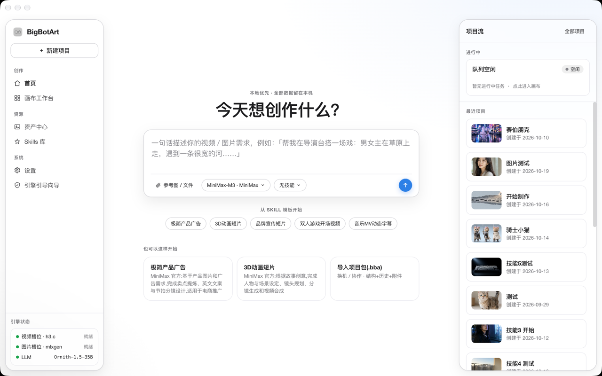
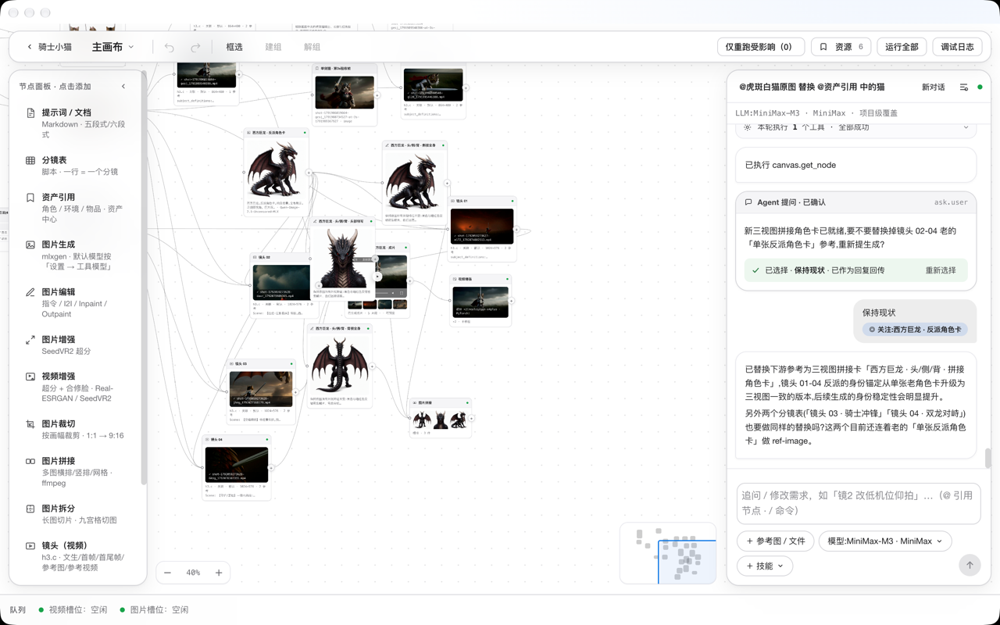
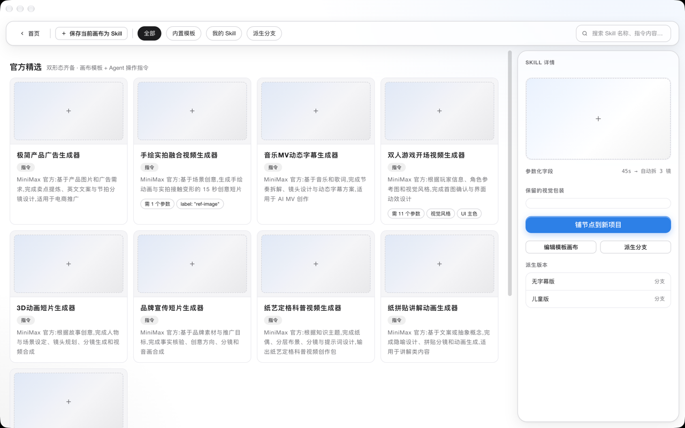

# BigBotArt

[](LICENSE)

官网：https://www.bigbot.art/

本地优先的无限画布，把一句话编排成可改、可复跑、可交付的视频和图片。

Electron desktop app for Apple Silicon. An agent lays out shots and images on an infinite canvas, then runs them on local engines: [h3.c](https://github.com/antirez/h3) for MiniMax-H3 video, and MLX (`mlxgen`) for images.

数据、素材和成片都留在本机（`~/.bigbotart`）。没有云端账号，也没有订阅。

<!-- AI 可读摘要开始 / AI-READABLE SUMMARY -->

> **AI 摘要**：BigBotArt 是一款本地优先（local-first）的 macOS 无限画布 AI 视频与图片生成 Agent 应用（Electron + TypeScript，面向 Apple Silicon）。用户输入一句话需求、图或文档，Agent 在无限画布上拆出分镜、镜头与图片节点并逐个执行，用本机引擎 h3.c（MiniMax-H3 权重约 144GB，Metal 推理）生成带音轨的镜头级视频，用 mlxgen（MLX）做图片生成与编辑，用 ffmpeg 剪辑并导出。项目、画布、Take 与素材只写入 `~/.bigbotart`，素材不上传云端，无账号、无订阅。运行要求：Apple Silicon Mac、Node.js ≥ 22、pnpm、ffmpeg；模型可后装，缺失时应用以 dry-run 占位运行。许可证 MIT。
>
> **AI Summary (EN)**: BigBotArt is a local-first infinite-canvas agent app for macOS (Electron + TypeScript, Apple Silicon) that turns a one-sentence brief into editable, re-runnable, deliverable video and image projects. The agent lays out storyboard, shot, and image nodes on the canvas and executes them on local engines — h3.c (MiniMax-H3 weights, ~144GB, Metal) for shot-level video with audio, mlxgen (MLX) for image generation and editing, and ffmpeg for editing and export. Projects, canvases, takes, and assets stay on your machine under `~/.bigbotart`; nothing is uploaded to a cloud, no account, no subscription. Requirements: an Apple Silicon Mac, Node.js ≥ 22, pnpm, and ffmpeg; models are optional at install time (the app runs in dry-run mode without them). Licensed under MIT.
>
> 官网 https://www.bigbot.art ・ 下载与更新日志 https://github.com/jiangzhenguo/bigbot.art/releases ・ 产品文档 [`docs/`](docs/) ・ AI 索引 [`llms.txt`](llms.txt)

<!-- AI 可读摘要结束 / END AI-READABLE SUMMARY -->



## 能做什么

在画布上把节点连起来，自己跑，或让右侧的 Agent 代劳。

| | |
|---|---|
| **一句话起活** | 首页写下需求。Agent 拆成文档、分镜、镜头和图片节点，再逐个提交。 |
| **画布可干预** | 改提示词、换参考图、调档位，只重跑受影响的节点。每次生成留下一条 Take，可以回看。 |
| **图片** | 文生图、指令编辑、图生图、局部重绘、扩图、超分，以及裁切、拼接、拆分。 |
| **视频** | 文生视频、首帧、首尾帧、参考图、参考视频、音频参考。成片自带音轨。出片后可去块、超分、修脸。 |
| **视频回到图片** | 从成片截一帧，接回图片编辑或下一镜的首帧。 |
| **技能** | 把一套做法存成技能。换主题时沿用同一套流程，只改内容。 |
| **项目可以搬走** | 导出 `.bba` 项目包（画布、对话记忆、用户素材）。生成产物不打包，换机后按参数重跑。 |

节点面板里现在能用的类型：提示词 / 文档、分镜表、资产、图片生成、图片编辑、图片增强、视频增强、裁切、拼接、拆分、镜头、视频取帧、音频参考、时间线。

## 界面

八个页面：首页、画布、项目、资产、技能、时间线、设置、引擎引导。画布支持平移缩放、拖拽连线、框选、分组、撤销重做。主题跟随系统的浅色 / 深色。

画布是自研的：DOM 节点、SVG 连线、CSS 变换。没有使用 React Flow。





## 它怎么串起来

```text
首页 / 画布 / Agent 面板          React（渲染进程）
        │  IPC
主进程                        项目、队列、技能、看图、ffmpeg
        │
        ├── Agent 子进程       对话、工具调用（stdio JSON-RPC）
        ├── h3.c              视频（Metal，本机二进制）
        ├── mlxgen            图片（MLX）
        └── ~/.bigbotart      项目、画布、Take、资产
```

渲染进程不直接碰 Node 或引擎。一切能力走类型化的 IPC 契约 `BigBotArtApi`。

## 环境

面向 Apple Silicon Mac。视频引擎 h3.c 走 Metal，图片引擎走 MLX，换到 Intel 或非 macOS 后这两个引擎不可用。

| 依赖 | 用途 |
|---|---|
| Node.js ≥ 22、pnpm | 安装与启动 |
| ffmpeg | 占位视频、裁切、拼接、拆分、抽帧、时间线导出 |
| [h3.c](https://github.com/antirez/h3) + MiniMax-H3 权重 | 真实出视频。模型约 144GB，预览档也要一两分钟 |
| `mlxgen`（安装 `mlx-gen-jzg`，不要装上游 `mlx-gen`） | 真实出图、编辑、超分。安装见 [图片引擎文档](docs/mlxgen-图片引擎-安装与模型管理.md) |
| LM Studio，或任意 OpenAI 兼容端点 | Agent 对话。配了远端就用远端，否则回退本地 `127.0.0.1:1234`，都不可达时用模板拆镜 |

没有模型也能打开应用：dry-run 只构造命令并落占位结果，用来看界面和走流程。

## 快速开始

```bash
pnpm install
pnpm dev:dry    # 开发默认：不加载模型
pnpm dev        # 真实推理：调用本机 h3.c / mlxgen
```

真实跑要两层同时打开：启动命令带 `BIGBOTART_DRYRUN=0`（`pnpm dev` 已经带上），并且设置里的推理模式是「真实」。只开一层时，任务会显示成功，但产物是占位文件。

常用脚本：

```bash
pnpm test          # vitest
pnpm typecheck     # 全仓库 tsc --noEmit
pnpm build         # electron-vite build
pnpm start         # 运行构建产物（真实推理）
```

Agent 的密钥放在本机 `.env`（参考 [`.env.example`](.env.example)），不要写进会被提交的文件。

## 仓库

```text
apps/desktop          Electron 主进程、preload、React 渲染层
packages/shared       领域类型与 IPC 契约（唯一类型来源）
packages/providers    h3.c / mlxgen / mock，经 registry 选择
packages/agent        Agent 子进程：规划、对话、工具协议
```

mock Provider 用 ffmpeg 生成带音轨的占位 MP4，不需要模型，适合把界面走通。

## 文档

| 文档 | 内容 |
|---|---|
| [图片引擎](docs/mlxgen-图片引擎-安装与模型管理.md) | mlxgen 安装、模型下载与本地目录 |
| [技能怎么写](docs/Agent技能文档-撰写指南与模板.md) | 给 Agent 的操作手册 |
| [AGENTS.md](AGENTS.md) | 给人和编码代理的仓库约定 |

## 状态

`0.1.1`，持续在本机使用和改。导演台、工作流入口 / 出口三类节点的类型还在，面板里已经下架：点了不会真正执行。

## 致谢

界面、对话和队列是这里写的。生成本身站在下面这些项目上，感谢作者把它们公开出来。

| 项目 | 在这里的角色 | 协议 |
|---|---|---|
| [h3.c](https://github.com/antirez/h3) | Apple Silicon 上的 MiniMax-H3 视频推理，Salvatore Sanfilippo | MIT |
| [mflux](https://github.com/mflux-community/mflux) | MLX 图片生成的底子，Filip Strand 与社区 | MIT |
| [mlx-gen](https://github.com/lpalbou/mlx-gen) | 本应用实际调用的 `mlxgen`，mflux 的分支，Laurent-Philippe Albou | MIT |
| [MLX](https://github.com/ml-explore/mlx) | Apple 的数组框架，图片引擎跑在上面 | MIT |
| [Pi](https://github.com/earendil-works/pi) | Agent 用的多供应商 LLM API（`@earendil-works/pi-ai`），Mario Zechner | MIT |
| [Electron](https://www.electronjs.org/) | 桌面外壳 | MIT |
| [React](https://react.dev/) | 界面 | MIT |
| [Vite](https://vite.dev/) | 构建（经 electron-vite） | MIT |
| [TypeScript](https://www.typescriptlang.org/) | 语言 | Apache-2.0 |
| [FFmpeg](https://ffmpeg.org/) | 裁切、拼接、拆分、抽帧、时间线导出。本仓库不附带二进制 | LGPL / GPL，随本机的构建 |
| [Real-ESRGAN](https://github.com/xinntao/Real-ESRGAN)、[GFPGAN](https://github.com/TencentARC/GFPGAN)、[CodeFormer](https://github.com/sczhou/CodeFormer) | 视频增强（超分与修脸）的可选后处理，脚本与权重在本机另装 | 各自仓库的协议 |

[MiniMax](https://github.com/MiniMax-AI/MiniMax-H3) 提供了 H3 模型，以及内置技能所改编的官方技能文档。模型权重遵循 [MiniMax H3 社区许可](https://huggingface.co/MiniMaxAI/MiniMax-H3/blob/main/LICENSE)，不在本仓库的 MIT 之内。Qwen、FLUX、Z-Image、SeedVR2 等图片权重同理，各归各的模型许可。

## 开源协议

本仓库的代码以 [MIT License](LICENSE) 授权。Copyright (c) 2026 姜振国。

MIT 只覆盖这个仓库里的代码。模型权重、`h3` / `mlxgen` / `ffmpeg` 这些外部程序，以及内置技能文档的上游原文，都沿用它们自己的协议。调用它们不会把那些协议改写成 MIT。
